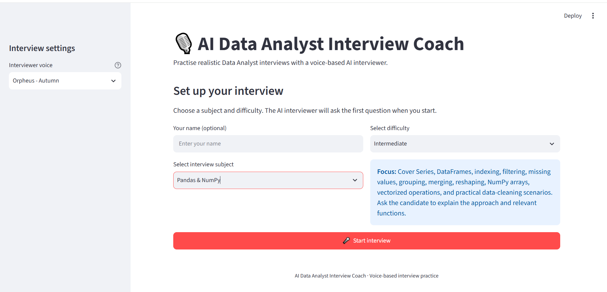
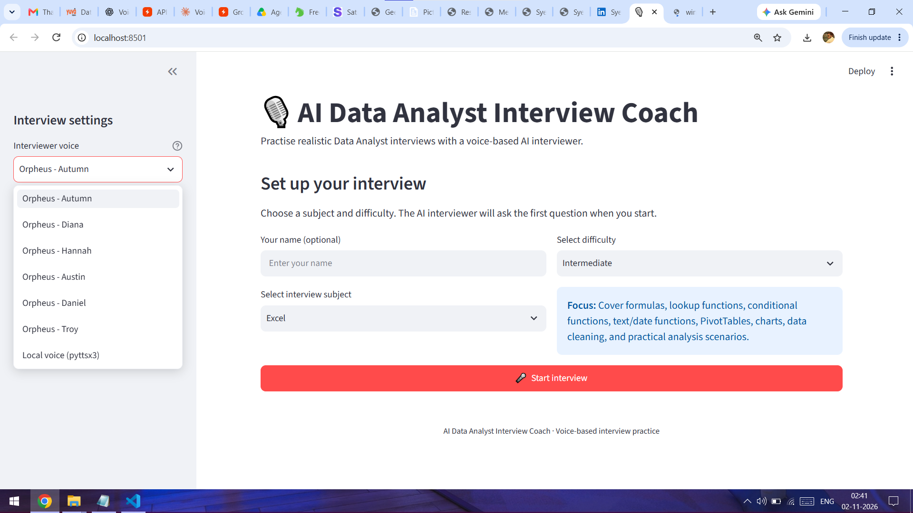
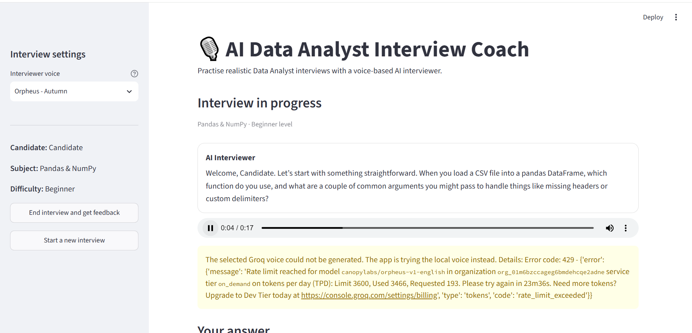
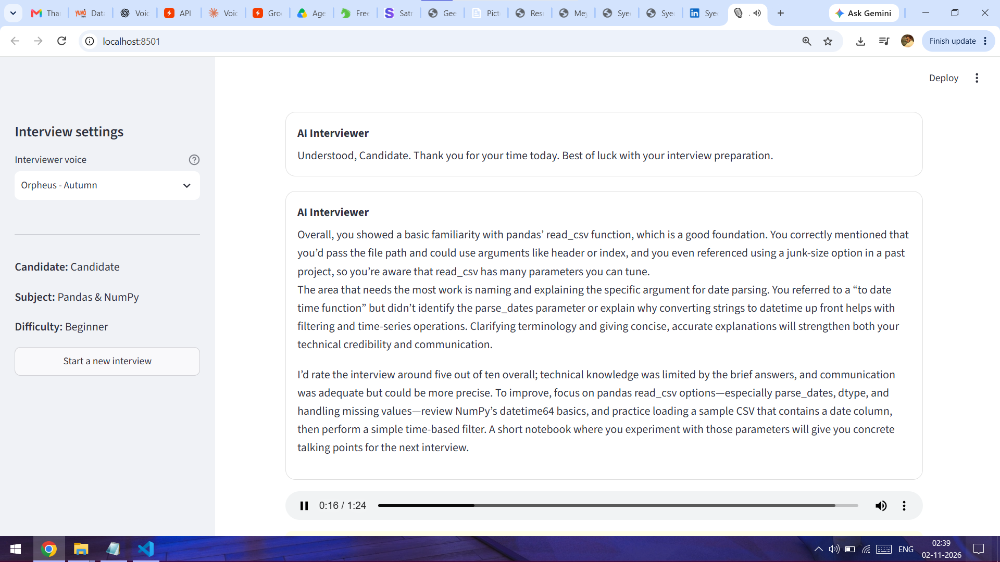

# AI Data Analyst Interview Coach

An AI-powered, voice-based interview practice application built with **Python, Streamlit, and Groq**. It simulates a Data Analyst interview, asks questions based on the selected subject and difficulty, listens to spoken answers, asks relevant follow-up questions, and provides a final performance review.

The goal is to help candidates practise explaining concepts and solving realistic data-analysis problems in a spoken interview setting.

---

## Table of Contents

- [Features](#features)
- [Supported Interview Categories](#supported-interview-categories)
- [How It Works](#how-it-works)
- [Technology Stack](#technology-stack)
- [Project Structure](#project-structure)
- [Screenshots](#screenshots)
- [Getting Started](#getting-started)
- [Configuration](#configuration)
- [Running the Application](#running-the-application)
- [Using the Interview Coach](#using-the-interview-coach)
- [Voice and Audio](#voice-and-audio)
- [Important Notes and Limitations](#important-notes-and-limitations)
- [Troubleshooting](#troubleshooting)
- [Future Improvements](#future-improvements)

---

## Features

- **AI-led interviews:** The interviewer starts the session and asks one question at a time.
- **10 interview categories:** Practise technical, analytical, business, and behavioural topics.
- **3 difficulty levels:** Choose Beginner, Intermediate, or Advanced.
- **Context-aware follow-ups:** The AI uses the candidate's previous response to decide whether to ask a follow-up or move to the next question.
- **Theory and scenario-based questions:** Questions are designed to test conceptual understanding and practical reasoning, not just code writing.
- **Voice-based answers:** Record answers using the microphone connected to the computer running the application.
- **Transcript review:** Stop recording, review the recognized answer, and submit it only when ready. You can also record again.
- **Multiple interviewer voices:** Choose from Groq Orpheus voices or use the local text-to-speech fallback.
- **Spoken AI responses:** Interviewer questions and feedback can be played as audio.
- **Final performance review:** Receive an overall score and feedback on technical knowledge, communication, strengths, and areas to improve.
- **Interview history:** Review the questions and answers from the completed session in the app.
- **Light Streamlit interface:** Uses Streamlit's default light appearance with a simple chat-style interview layout.

## Supported Interview Categories

| Category | Example areas covered |
|---|---|
| SQL | Joins, grouping, subqueries, CTEs, window functions, query logic, and business scenarios |
| Python | Data types, collections, functions, loops, comprehensions, exceptions, and data-processing approaches |
| Pandas & NumPy | DataFrames, filtering, missing values, grouping, merging, arrays, and vectorized operations |
| Statistics | Descriptive statistics, probability, distributions, hypothesis testing, and correlation |
| Power BI | Power Query, data modelling, relationships, DAX, measures, and dashboard design |
| Excel | Formulas, lookups, conditional functions, PivotTables, charts, and data cleaning |
| Machine Learning | Regression, classification, clustering, overfitting, feature engineering, and evaluation metrics |
| Data Analysis & Business Cases | KPIs, trend analysis, root-cause analysis, insights, and recommendations |
| HR & Behavioural | Introduction, career motivation, teamwork, problem-solving, and workplace situations |
| Mixed Interview | A combination of relevant Data Analyst interview topics |

Each category can be practised at **Beginner, Intermediate, or Advanced** difficulty.

## How It Works

1. The candidate selects an interview category, difficulty level, and interviewer voice.
2. The application sends the interview instructions and selected settings to the Groq-hosted language model.
3. The AI interviewer generates the opening question and subsequent questions based on the conversation.
4. The candidate records an answer using the computer's microphone.
5. SpeechRecognition sends the recording to Google's speech recognition service and returns a text transcript.
6. The candidate reviews the transcript and chooses to submit it or record again.
7. The transcript is sent to the language model, which generates the next response or a relevant follow-up question.
8. The response is converted into speech using Groq Orpheus TTS. Long responses are split into chunks of up to 200 characters before audio generation, then combined for playback.
9. At the end of the interview, the language model reviews the candidate's answers and generates a spoken-style performance debrief, which is also displayed as text.

## Technology Stack

| Technology | Purpose |
|---|---|
| Python | Application logic and audio processing |
| Streamlit | Web-based user interface |
| Groq API | Access to the language model and text-to-speech service |
| Groq-hosted LLM | Generates interview questions, follow-ups, and final feedback |
| Groq Orpheus TTS | Converts interviewer responses into speech |
| SpeechRecognition | Converts recorded speech into text using Google's recognition service |
| PyAudio | Captures audio from the computer's microphone |
| pyttsx3 | Local text-to-speech fallback if Groq TTS is unavailable |
| python-dotenv | Loads API keys and configuration from the `.env` file |

## Project Structure

```text
AI-Data-Analyst-Interview-Coach/
│
├── app.py                         # Main Streamlit application
├── requirements.txt               # Python dependencies
├── .env.example                   # Sample environment configuration
├── .gitignore                     # Excludes secrets and local environment files
├── README.md                      # Project documentation
└── screenshots/
    ├── Home.png                   # Interview setup screen
    ├── Voice_Models.png           # Available interviewer voices
    ├── Interview_Question_Sample.png  # Example interview conversation
    └── Feedback.png               # Example final feedback screen
```

## Screenshots

### 1. Interview Setup

Choose the interview category and difficulty before starting the session.



### 2. Interviewer Voice Selection

Choose one of the available Orpheus voices or the local voice fallback.



### 3. Interview Conversation

The AI interviewer asks questions and responds to the candidate's submitted answers.



### 4. Final Feedback

Review the AI-generated assessment after completing the interview.



---

## Getting Started

### Prerequisites

- Python **3.10 or newer**
- A Groq account and API key
- A working microphone connected to the computer
- Internet access for Groq API requests and Google speech recognition
- A supported audio input device and working PyAudio installation

### 1. Clone the Repository

```bash
git clone https://github.com/syedrhn0/AI-Data-Analyst-Interview-Coach.git
cd AI-Data-Analyst-Interview-Coach
```

### 2. Create a Virtual Environment

**Windows (PowerShell):**

```powershell
python -m venv .venv
.\.venv\Scripts\Activate.ps1
```

**macOS / Linux:**

```bash
python3 -m venv .venv
source .venv/bin/activate
```

### 3. Install Dependencies

```bash
python -m pip install --upgrade pip
pip install -r requirements.txt
```

**PyAudio note:** PyAudio installation can depend on your operating system and Python version. If installation fails, install the appropriate PortAudio/PyAudio package for your platform before continuing.

### 4. Configure the Groq API Key

1. Create an API key from the [Groq Console](https://console.groq.com/keys).
2. Copy `.env.example` and rename the copy to `.env`.
3. Open `.env` and replace the placeholder with your API key.

Example:

```env
GROQ_API_KEY=your_actual_groq_api_key
GROQ_LLM_MODEL=openai/gpt-oss-120b
GROQ_TTS_MODEL=canopylabs/orpheus-v1-english
GROQ_TTS_VOICE=autumn
```

Keep your `.env` file private. It is excluded from Git through `.gitignore`. **Never commit your API key to GitHub.**

### 5. Run the Application

```bash
streamlit run app.py
```

Streamlit will display a local address in the terminal, usually:

```text
http://localhost:8501
```

Open that address in your browser while keeping the application running in the terminal.

## Configuration

The application reads the following optional settings from `.env`:

| Variable | Description | Default |
|---|---|---|
| `GROQ_API_KEY` | API key used for Groq LLM and Orpheus TTS requests | Required for AI interview functionality |
| `GROQ_LLM_MODEL` | Groq-hosted chat model used by the interviewer | `openai/gpt-oss-120b` |
| `GROQ_TTS_MODEL` | Text-to-speech model | `canopylabs/orpheus-v1-english` |
| `GROQ_TTS_VOICE` | Default Orpheus voice | `autumn` |

The model names and availability are controlled by Groq and may change. Use model IDs currently available to your Groq account.

## Running the Application

### 1. Set Up an Interview

- Enter your name (optional).
- Select one of the 10 interview categories.
- Choose Beginner, Intermediate, or Advanced difficulty.
- Select an interviewer voice from the sidebar.
- Click **Start interview**.

### 2. Answer Questions

- Click **Start Recording** and answer using your computer's microphone.
- Click **Stop Recording** when you finish speaking.
- Review the recognized transcript.
- Click **Submit Answer** to send it to the interviewer, or **Record Again** to retry.
- The interviewer will respond and continue the interview based on your answer.

Recording does not automatically submit an answer when you pause. You control when recording stops and when the transcript is submitted.

### 3. Finish the Interview

- Click **End interview and get feedback** in the sidebar, or use a supported spoken end phrase such as "I'm done, give me feedback" and submit that transcript.
- The application reviews the answers from the current session.
- The final feedback is displayed and can also be played as audio.
- Choose **Start a new interview** to begin another session.

## Voice and Audio

### Interviewer Voices

The application provides these voice choices:

- Orpheus: Autumn
- Orpheus: Diana
- Orpheus: Hannah
- Orpheus: Austin
- Orpheus: Daniel
- Orpheus: Troy
- Local voice using `pyttsx3`

The Orpheus voices require a working Groq API key and access to the selected TTS model. The local `pyttsx3` option is a fallback and may sound more robotic than the hosted voices.

### Text-to-Speech Chunking

The application splits longer responses into chunks of no more than **200 characters** before sending them to Orpheus TTS. It then combines the generated WAV audio chunks for playback. This avoids sending an oversized text input in a single TTS request.

### Speech-to-Text

The microphone recording is captured locally through PyAudio and SpeechRecognition. The recorded audio is transcribed using Google's online speech recognition service, so an internet connection is required for transcription.

---

## Important Notes and Limitations

- **Local microphone requirement:** The current version captures audio from the computer running Streamlit. It is intended to run locally. Deploying it to a public server will not automatically give the server access to a visitor's browser microphone; browser-side audio capture would need to be implemented separately.
- **Internet connection:** Groq requests and Google speech recognition require internet access.
- **API access and usage:** Groq model access, rate limits, terms, and any charges depend on your account and the provider's current policies.
- **TTS fallback:** If Orpheus TTS fails, the app attempts to use local `pyttsx3` speech output. Local voice quality and availability depend on the operating system's installed voices.
- **Recognition accuracy:** Speech-to-text quality can be affected by background noise, microphone quality, accent, and speaking speed. Review the transcript before submitting it.
- **Feedback quality:** The final assessment is AI-generated and should be treated as practice guidance, not as a formal or guaranteed measure of interview performance.
- **Session storage:** Interview conversation and feedback are maintained in the current Streamlit session; this project does not include a database for long-term interview history.

## Troubleshooting

| Problem | What to check |
|---|---|
| `GROQ_API_KEY` error | Confirm that `.env` exists in the project root and contains a valid key. Restart Streamlit after changing environment settings. |
| Groq model error | Check that the model ID in `.env` is currently available to your Groq account. |
| Orpheus voice does not play | Check API access and model availability. If required, review and accept the model terms in the Groq Console. The app may fall back to `pyttsx3`. |
| Microphone not detected | Check operating-system microphone permissions, the selected input device, and the PyAudio installation. |
| Speech not transcribed | Check internet access, microphone clarity, background noise, and whether the recording contains speech. |
| PyAudio installation fails | Check the installation instructions for your operating system and Python version, including any PortAudio requirements. |
| Local voice does not work | Check that your operating system has an available text-to-speech voice and that `pyttsx3` installed correctly. |

---

## Future Improvements

Possible extensions for future versions include:

- Browser-based microphone recording for easier cloud deployment.
- Downloadable interview reports and session history.
- More detailed answer-by-answer scoring and progress tracking.
- Custom interview duration and question-count settings.
- Additional language and voice options.

---

## Author

**Syed Rehan Syed Hamedsaleem**  
Aspiring Data Analyst

- **GitHub:** [@syedrhn0](https://github.com/syedrhn0)
- **LinkedIn:** [syedrhn0](https://www.linkedin.com/in/syedrhn0/)

---

## License

No license file is currently included in this repository. If you want others to reuse, modify, or distribute this project, add a license that matches your intentions (for example, the MIT License). Until then, do not assume the project is open-source licensed.
